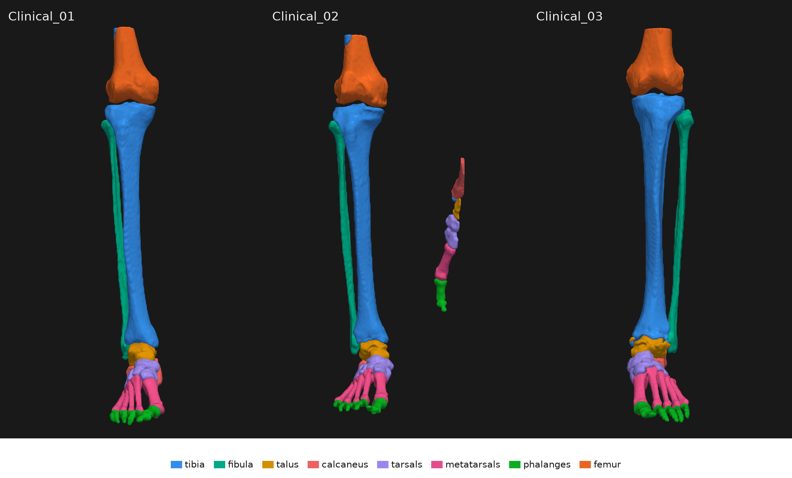
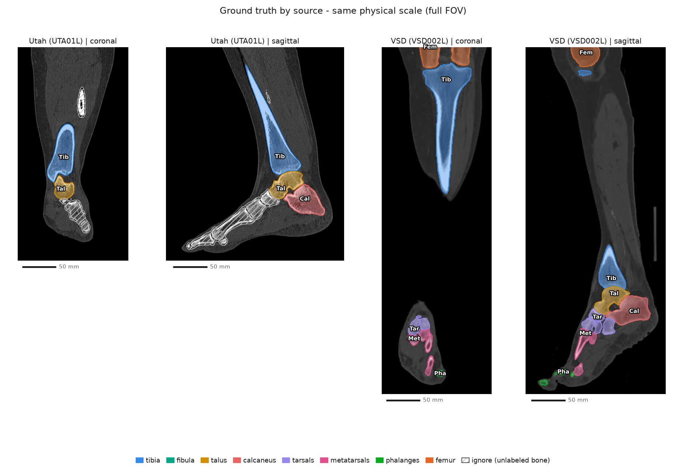
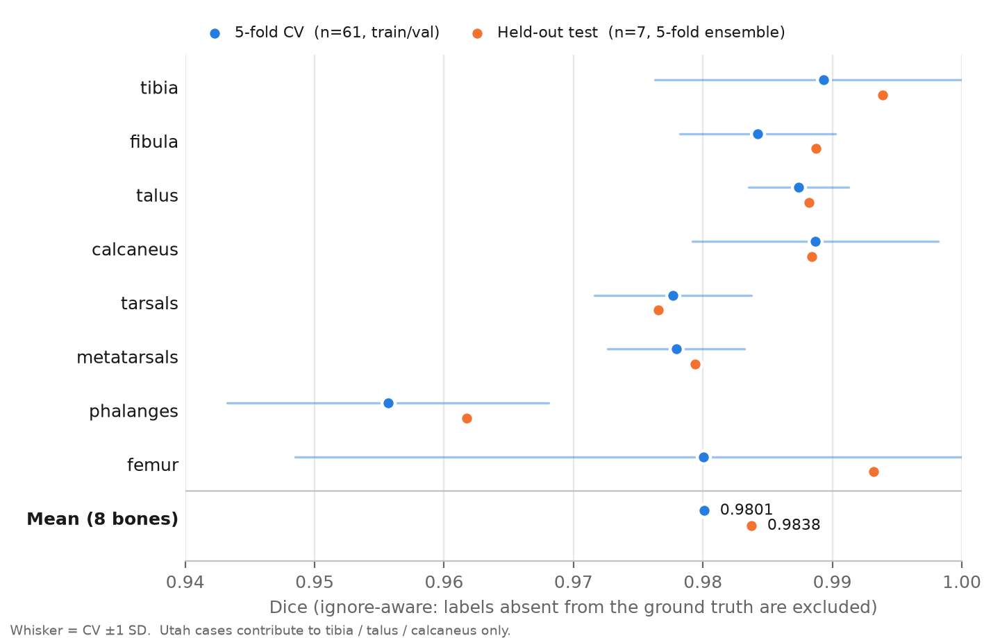
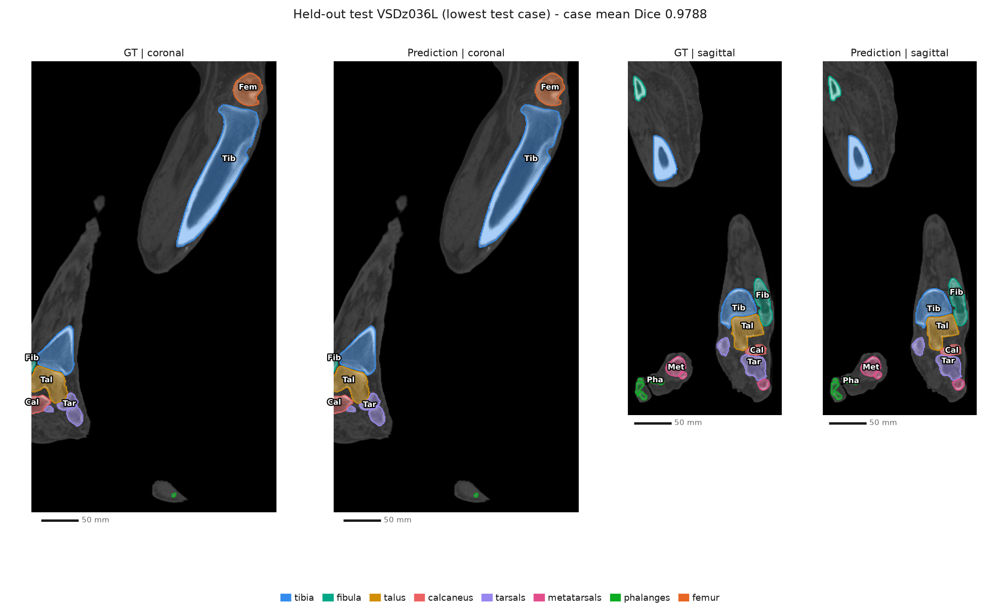
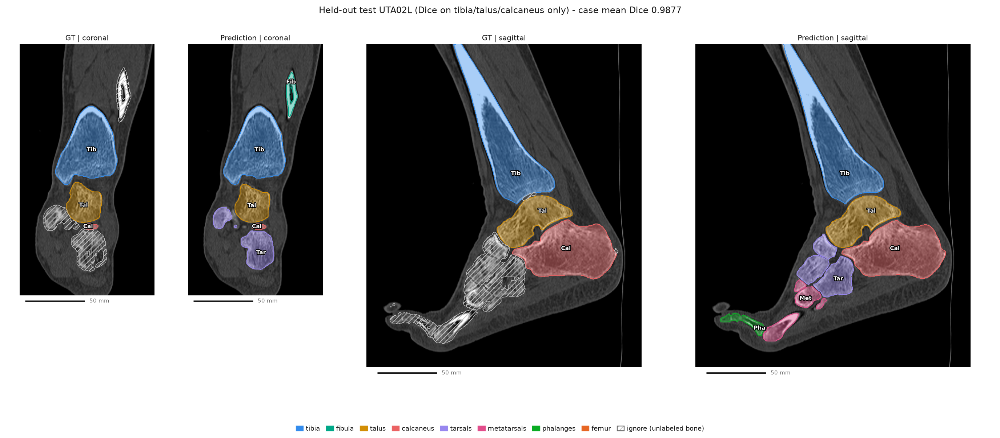
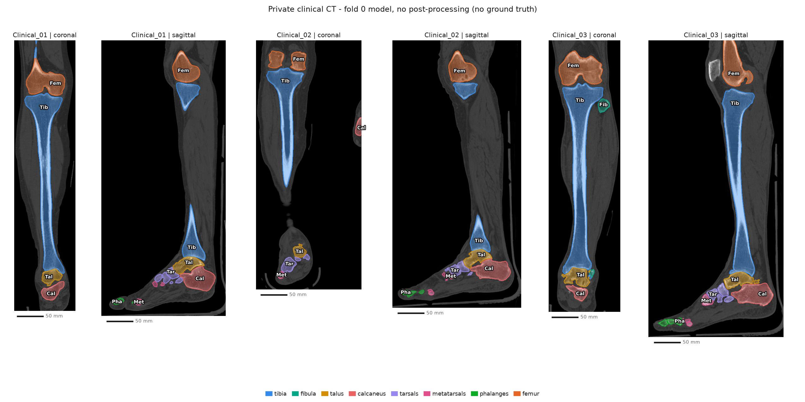
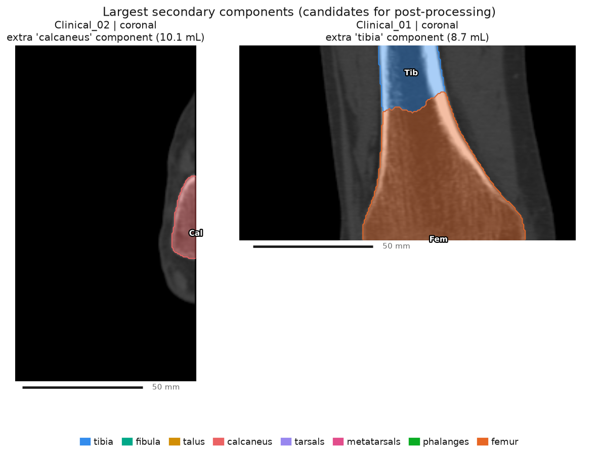

# Ankle_Segmentation



<br>

## - Purpose

```
족부·족관절 수술 계획을 위한 하지 골 구조(대퇴골 원위부 ~ 족지골) 자동 Segmentation AI
공개 데이터셋 2종(VSD, Utah)을 합쳐 학습하고, 실제 임상 CT에서 동작 확인
```

<!-- TODO: 실제 적용 목적(수술 종류 / 서비스 형태)에 맞게 수정 -->

<br>

## - Process

#### Lower Leg / Foot Bone Segmentation

1. DB 준비
   - VSD Lower Leg (Open) - 8개 뼈 전체 라벨
   - Utah Ankle (Open) - tibia / talus / calcaneus 3개 뼈만 라벨
   - 임상 CT (Private, 3건) - Inference 검증용, 정답 없음

2. Pre-processing (데이터셋 통합 → Dataset304_AnkleCombined)
   - 다리 1개 = 1 case (VSD는 좌/우 분리, 파일명 끝 `L`/`R`)
   - 라벨 통일: 8개 뼈, 좌우 구분 없음 (side-less)
   - Utah의 미라벨 뼈 → `ignore(9)` (loss·평가에서 제외)
   - Orientation 통일: LPS
   - nnU-Net 자동 전처리: Foreground crop, CT Normalization, Resampling (1.04 × 1.04 × 0.5 mm)

3. Segmentation
   - 3D nnU-Net v2, Residual Encoder U-Net (ResEnc-M)
   - 5-fold Cross-Validation, 1000 epochs

4. Evaluation
   - Held-out Test 7건 (환자 단위로 Train과 분리)
   - ignore-aware Dice (정답에 없는 라벨은 해당 케이스에서 제외)

5. Clinical Inference
   - 임상 CT 3건, fold 0 모델

6. Post-processing - 개발 예정
   - 대상 다리 선택 + 라벨별 Connected Component 정리
   - Mesh 변환 (`nii2stl.py`)

<br>

---

<br>

### - DB



| Dataset | 출처 | License | Subjects | Cases (Train / Test) | 라벨 | Spacing (median, in-plane / slice) | S-I FOV (median) |
| :---: | :---: | :---: | :---: | :---: | :---: | :---: | :---: |
| VSD Lower Leg | VSDFullBodyBone, Shanks-Feet ([doi](https://doi.org/10.1038/s41597-023-02669-z)) | CC BY-NC-SA 4.0 | 29 | 52 / 6 | 8개 뼈 | 1.08 / 0.5 mm | 556 mm |
| Utah Ankle | Utah tibiotalar arthrodesis study, 미치료(NonAD) 하지 ([doi](https://doi.org/10.2106/jbjs.19.01132)) | CC BY 4.0 | 10 | 9 / 1 | 3개 뼈 + ignore | 0.30 / 0.5 mm | 264 mm |
| **Combined (Dataset304)** | VSD + Utah | - | **39** | **61 / 7** | 8개 뼈 + ignore | 1.04 / 0.5 mm (학습 spacing) | - |
| 임상 CT | Private | - | 3 | - / 3 (정답 없음) | - | 0.56–0.60 / 0.625 mm | 523–563 mm |

- 라벨 구성

| Label | 뼈 | VSD | Utah |
| :---: | :--- | :---: | :---: |
| 1 | tibia | V | V |
| 2 | fibula | V | ignore |
| 3 | talus | V | V |
| 4 | calcaneus | V | V |
| 5 | tarsals (talus·calcaneus 제외 족근골) | V | ignore |
| 6 | metatarsals | V | ignore |
| 7 | phalanges | V | ignore |
| 8 | femur (원위부) | V | FOV 밖 |
| 9 | ignore | - | 미라벨 뼈 |

```
두 데이터셋의 성격이 다름
- VSD : 무릎~발끝 전체 FOV (S-I 약 56 cm), 8개 뼈 전부 라벨, 해상도 약 1 mm
- Utah : 발목 중심 FOV (S-I 약 26 cm), 3개 뼈만 라벨, 해상도 약 0.3 mm (고해상도)

Utah의 미라벨 뼈(fibula, 족근골 등)를 background(0)로 두면
"fibula = 배경"을 학습하게 되어 VSD 라벨과 충돌함
→ ignore(9)로 지정해 loss 계산에서 제외 (nnU-Net v2 ignore label 기능)
```

<br>

### - Model

```
3D nnU-Net Version2 (v2.8.1) - Residual Encoder U-Net (ResEnc-M preset), 3d_fullres
```

| 항목 | 설정 |
| :---: | :--- |
| Planner / Plans | `nnUNetPlannerResEncM` / `nnUNetResEncUNetMPlans` |
| Architecture | ResidualEncoderUNet, 6 stages, features 32→320, residual blocks [1, 3, 4, 6, 6, 6] |
| Target spacing | 1.04 × 1.04 × 0.5 mm |
| Patch size | 64 × 352 × 48 voxel (≈ 66 × 176 × 50 mm, 긴 축 = S-I) |
| Batch size | 2 |
| Normalization | CTNormalization (foreground 0.5–99.5 percentile [-379, 2537] HU clip → z-score) |
| Loss | Dice + Cross-Entropy, Deep Supervision |
| Optimizer | SGD (Nesterov, momentum 0.99), lr 0.01 poly decay, weight decay 3e-5 |
| Epochs | 1000 epochs × 250 iterations, foreground oversampling 0.33 |
| GPU | RTX A4000 16GB × 1 (fold당), 약 122 s/epoch → fold당 약 34시간 |
| Inference | Sliding window + mirroring TTA, 단일 fold 기준 임상 CT 1건당 약 5–7분 |

<br>

### - Training (5-fold)

| Fold | Val cases (Utah) | Epochs | Best EMA pseudo Dice | Val Dice (ignore-aware) | Val Dice (nnU-Net 기본) | 비고 |
| :---: | :---: | :---: | :---: | :---: | :---: | :---: |
| 0 | 13 (1) | 1000 | 0.9771 | **0.9821** | 0.9446 | |
| 1 | 12 (2) | 1000 | 0.9747 | 0.9792 | 0.9070 | |
| 2 | 12 (4) | 1000 | 0.9743 | 0.9789 | 0.8401 | |
| 3 | 12 (1) | 1000 | 0.9744 | 0.9800 | 0.9395 | |
| 4 | 12 (1) | 1000 | 0.9737 | 0.9799 | 0.9394 | 중단 후 `--c`로 재개 |
| **All** | **61 (9)** | | | **0.9801** | 0.9153 | |

```
nnU-Net 기본 Dice는 val에 Utah 케이스가 많을수록 낮아짐 (fold 2: Utah 4건 → 0.8401)
→ 모델 문제가 아니라 평가 방식 문제. 아래 Results 1 참고.
```

<br>

---

<br>

## - Results

### 1. 평가 지표 보정 (ignore-aware Dice)

| | nnU-Net 기본 (foreground_mean) | ignore-aware | 정답 없는 라벨을 예측한 항목 수 |
| :---: | :---: | :---: | :---: |
| 5-fold CV (61) | 0.9153 | **0.9801** | 32 |
| Held-out Test (7) | 0.9140 | **0.9838** | 4 |

```
- 원인
nnU-Net summary.json은 "정답이 비어 있는데 예측이 있으면 Dice = 0"으로 평균에 넣음.
Utah 케이스는 fibula / tarsals / metatarsals / phalanges가 ignore라서 정답이 비어 있음
→ 모델이 이 뼈들을 분할하면 라벨마다 Dice 0이 들어가 평균이 크게 떨어짐.

- 확인 (Test UTA02L)
해당 4개 라벨 예측의 92–97%는 ignore 영역 내부 (평가에서 제외됨),
나머지 예측 voxel의 64–89%도 ignore 경계 2 voxel 이내 (ignore 마스크의 경계 오차)
→ 실제 오분할이 아니라 평가 방식 때문에 생긴 수치

- 대응
정답에 없는 라벨(n_ref = 0)은 해당 케이스-라벨 항목에서 제외하고 평균
(Scripts/compare_folds.py 의 fg(빈정답제외) 열과 동일한 정의, 이하 모든 수치에 적용)
```

<br>

### 2. 라벨별 성능



| Label | 5-fold CV (n=61) | Held-out Test, 5-fold ensemble (n=7) |
| :---: | :---: | :---: |
| tibia | 0.9893 | **0.9939** |
| fibula | 0.9842 | 0.9887 |
| talus | 0.9874 | 0.9882 |
| calcaneus | 0.9887 | 0.9884 |
| tarsals | 0.9777 | 0.9765 |
| metatarsals | 0.9779 | 0.9794 |
| phalanges | <u>0.9557</u> | <u>0.9618</u> |
| femur | 0.9800 | 0.9932 |
| **Mean** | **0.9801** | **0.9838** |

```
- 큰 뼈(tibia, talus, calcaneus, femur)는 0.98–0.99
- phalanges가 가장 낮음 (0.956 / 0.962): 작고 얇은 뼈 여러 개 + 약 1 mm 해상도의 partial volume 영향
- CV femur의 편차가 큼: VSDz050R(femur 0.801), VSDz057R(femur 0.876)
  → FOV 상단에 femur가 일부만 걸린 케이스
```

<br>

### 3. Test - Fold별 vs Ensemble

| Model | tibia | fibula | talus | calcaneus | tarsals | metatarsals | phalanges | femur | Mean |
| :---: | :---: | :---: | :---: | :---: | :---: | :---: | :---: | :---: | :---: |
| fold 0 | 0.9936 | 0.9892 | 0.9879 | 0.9868 | 0.9770 | 0.9791 | 0.9623 | 0.9925 | 0.9836 |
| fold 1 | 0.9939 | 0.9886 | 0.9881 | 0.9848 | 0.9766 | 0.9792 | 0.9628 | 0.9930 | 0.9834 |
| fold 2 | 0.9934 | 0.9878 | 0.9885 | 0.9894 | 0.9763 | 0.9777 | 0.9606 | 0.9929 | 0.9833 |
| fold 3 | 0.9926 | 0.9877 | 0.9871 | 0.9886 | 0.9765 | 0.9791 | 0.9600 | 0.9929 | 0.9831 |
| fold 4 | 0.9936 | 0.9847 | 0.9880 | 0.9887 | 0.9756 | 0.9795 | 0.9575 | 0.9930 | 0.9826 |
| **5-fold ensemble** | 0.9939 | 0.9887 | 0.9882 | 0.9884 | 0.9765 | 0.9794 | 0.9618 | 0.9932 | **0.9838** |

```
fold 간 차이 0.001 이내, ensemble 이득 +0.0002 ~ +0.0012
→ 단일 fold 모델로도 충분 (임상 inference에 fold 0 사용한 근거). ensemble은 추론 시간 5배.
```

<br>

### 4. 데이터셋(Source)별 성능

| Split | Source | Cases | Case-mean Dice (± SD) | Min |
| :---: | :---: | :---: | :---: | :---: |
| CV | Utah | 9 | 0.9852 ± 0.0042 | 0.9766 |
| CV | VSD | 52 | 0.9803 ± 0.0081 | 0.9451 |
| Test | Utah | 1 | 0.9877 | 0.9877 |
| Test | VSD | 6 | 0.9839 ± 0.0034 | 0.9788 |

- 단일 데이터셋 모델 (참고, fold 0 validation)

| Model | Train data | Val cases | Val Dice (ignore-aware) |
| :---: | :---: | :---: | :---: |
| Dataset303 (Utah only) | Utah 7 | 2 | 0.9835 (3개 뼈) |
| Dataset305 (VSD only) | VSD 41 | 11 | 0.9826 |
| Dataset304 (Combined) | Utah + VSD 48 | 13 | 0.9821 |

```
Utah는 학습 데이터가 9건뿐이지만 합성 학습에서 0.985 수준 유지.
단일 데이터셋 모델과 비교해도 합성으로 인한 성능 손실은 보이지 않음.
(단, validation split이 서로 달라 직접 비교는 불가 → 같은 Test set 비교 예정)

합성의 핵심 효과는 아래 Utah Test 시각화:
Utah 정답에는 3개 뼈만 있지만, 모델은 VSD에서 배운 나머지 5개 뼈까지 분할함.
```

<br>

### 5. Visualization (Held-out Test)

- VSD - Test 중 가장 낮은 케이스 (VSDz036L, 0.9788)



- Utah - 부분 라벨 케이스 (UTA02L, 3개 뼈 기준 0.9877)



```
GT의 빗금(ignore) 영역을 예측에서는 fibula / tarsals / metatarsals / phalanges로 채움.
부분 라벨 데이터(Utah)와 전체 라벨 데이터(VSD)를 ignore label로 합쳐 학습한 효과.
```

<br>

---

<br>

## - Clinical Inference (Private CT)

| 항목 | 내용 |
| :---: | :--- |
| Data | 임상 CT 3건 (512 × 512, 0.56–0.60 mm, slice 0.625 mm, 무릎~발끝 포함) |
| Model | fold 0 단일 모델 |
| Post-processing | 없음 (raw output) |
| 평가 | 정답 없음 → 정성 평가 + 부피 확인 |



- 예측 부피 (mL)

| Case | tibia | fibula | talus | calcaneus | tarsals | metatarsals | phalanges | femur |
| :---: | :---: | :---: | :---: | :---: | :---: | :---: | :---: | :---: |
| Clinical_01 | 239.2 | 46.5 | 29.6 | 57.8 | 31.5 | 36.4 | 11.6 | 131.0 |
| Clinical_02 | 223.3 | 42.8 | 29.4 | 57.3 | 40.0 | 44.1 | 14.5 | 128.6 |
| Clinical_03 | 352.6 | 62.8 | 42.3 | 68.6 | 41.7 | 46.1 | 15.8 | 182.2 |

(tibia / femur 부피는 FOV에 포함된 길이에 따라 달라짐. 라벨별 component 수와 추가 성분 부피는 `Results/clinical_volumes.csv`)

```
- 3건 모두 8개 뼈가 해부학적으로 올바른 위치에 분할됨
  → 학습에 쓰지 않은 병원 / 스캐너 / 촬영 자세에서도 동작 확인
```

- 오류 사례 (후처리 대상)



```
1. 반대쪽 발이 FOV에 걸린 경우 그 발도 분할 (Clinical_02, calcaneus 10.1 mL 등)
   → 라벨이 좌우 구분이 없으므로 모델 입장에선 정상 동작. 서비스에서는 대상 다리만 남겨야 함

2. FOV 상단에 걸린 대퇴골 간부 일부를 tibia로 분류 (Clinical_01 8.7 mL, Clinical_02 4.9 mL)
   → patch의 S-I 길이(176 mm) 안에 무릎 관절이 없으면 긴 뼈 간부를 구분할 단서가 부족한 것으로 추정

nnU-Net 자동 후처리(largest component)는 CV에서 개선이 없어 선택되지 않음 (postprocessing_fns = [])
학습 데이터는 다리 하나씩 crop되어 있어 이런 상황이 없기 때문 → 임상 FOV용 후처리는 직접 설계 필요
```

<br>

---

<br>

## - 분석 / 결론

```
1. VSD(전체 라벨, 넓은 FOV) + Utah(부분 라벨, 고해상도 발목)를 ignore label로 합쳐 학습
   → Held-out Test 0.9838, 5-fold CV 0.9801 (ignore-aware Dice)
2. nnU-Net 기본 지표(0.914)는 ignore 데이터셋에서 과소평가됨 → ignore-aware 지표로 보고
3. 부분 라벨 데이터(Utah)에서도 8개 뼈 전체를 분할 → 데이터셋 합성 효과
4. 임상 CT 3건에서 정성적으로 정상 동작, 단 반대쪽 다리 / FOV 상단 처리를 위한 후처리 필요
```

<br>

## - Next Steps

- [ ] 임상 CT 정량 평가: 수작업 GT 확보 (최소 3–5건) 후 Dice / HD95
- [ ] 후처리: 대상 다리 선택 (tibia 최대 성분 기준 좌우 분리) + 라벨별 connected component 정리 → Mesh 후처리 (Skull pipeline과 동일 구성)
- [ ] 환자 단위 CV split 재구성: 현재 `splits_final.json`은 다리 단위라 VSD val 52건 중 40건은 반대쪽 다리가 train에 포함됨 → CV 수치가 낙관적일 수 있음 (Held-out Test는 환자 단위 분리라 영향 없음)
- [ ] 단일 데이터셋 모델(303 / 305)을 같은 Test set에서 평가해 합성 효과 정량화
- [ ] 관련 논문 성능과 비교표 추가
- [ ] 5-fold ensemble 임상 적용 여부 결정 (Test 이득 ≤ 0.0012 vs 추론 시간 5배)

<br>

---

<br>

## - Reproduce

```bash
# 환경: nnU-Net v2.8.1, torch 2.14.1+cu126 (서버 /home/ug/nnunet/env/README.md)
nnUNetv2_plan_and_preprocess -d 304 -pl nnUNetPlannerResEncM -c 3d_fullres --verify_dataset_integrity
for f in 0 1 2 3 4; do nnUNetv2_train 304 3d_fullres $f -p nnUNetResEncUNetMPlans; done
nnUNetv2_find_best_configuration 304 -c 3d_fullres -p nnUNetResEncUNetMPlans

# Held-out Test (5-fold ensemble, fold별은 -f 0 등으로 따로)
nnUNetv2_predict -d 304 -i $nnUNet_raw/Dataset304_AnkleCombined/imagesTs -o predictions/Dataset304_Ts \
    -c 3d_fullres -p nnUNetResEncUNetMPlans -f 0 1 2 3 4
nnUNetv2_evaluate_folder $nnUNet_raw/Dataset304_AnkleCombined/labelsTs predictions/Dataset304_Ts \
    -djfile predictions/Dataset304_Ts/dataset.json -pfile predictions/Dataset304_Ts/plans.json

# ignore-aware Dice 비교
python Scripts/compare_folds.py predictions/Dataset304_Ts*/summary.json

# 이 페이지의 그림 / 표 재생성 (Results/*.csv, PNGs/*.png)
python Scripts/make_figures.py --nnunet /home/ug/nnunet
```

<br>

## - Folder

```
Research/Ankle/
├── README.md
├── PNGs/
│   ├── Dataset_Overview.png          # Utah vs VSD 정답 라벨 (같은 mm 스케일)
│   ├── Per_Label_Dice.png            # 라벨별 Dice (CV vs Test)
│   ├── Test_VSD_GT_vs_Pred.png       # Test 최저 케이스
│   ├── Test_Utah_GT_vs_Pred.png      # 부분 라벨 케이스
│   ├── Clinical_Inference_2D.png     # 임상 CT coronal / sagittal
│   ├── Clinical_Inference_3D.png     # 임상 CT 3D
│   └── Clinical_Error_Cases.png      # 후처리 대상 오류
├── Results/
│   ├── cv_per_fold.csv / cv_per_case.csv
│   ├── test_per_fold.csv / test_per_case.csv
│   ├── source_breakdown.csv          # Utah / VSD 별
│   └── clinical_volumes.csv          # 임상 예측 부피, component 수
└── Scripts/
    ├── compare_folds.py              # fold별 ignore-aware Dice 비교
    └── make_figures.py               # 위 CSV / PNG 생성
```

NIfTI 영상, 학습 checkpoint, 임상 CT는 올리지 않음 (용량, VSD 라이선스 CC BY-NC-SA, 개인정보)

<br>

## - Reference

- nnU-Net: Isensee et al., *nnU-Net: a self-configuring method for deep learning-based biomedical image segmentation*, Nature Methods (2021)
- ResEnc U-Net: Isensee et al., *nnU-Net Revisited: A Call for Rigorous Validation in 3D Medical Image Segmentation*, MICCAI (2024)
- VSD Lower Leg: https://doi.org/10.1038/s41597-023-02669-z
- Utah Ankle: https://doi.org/10.2106/jbjs.19.01132
